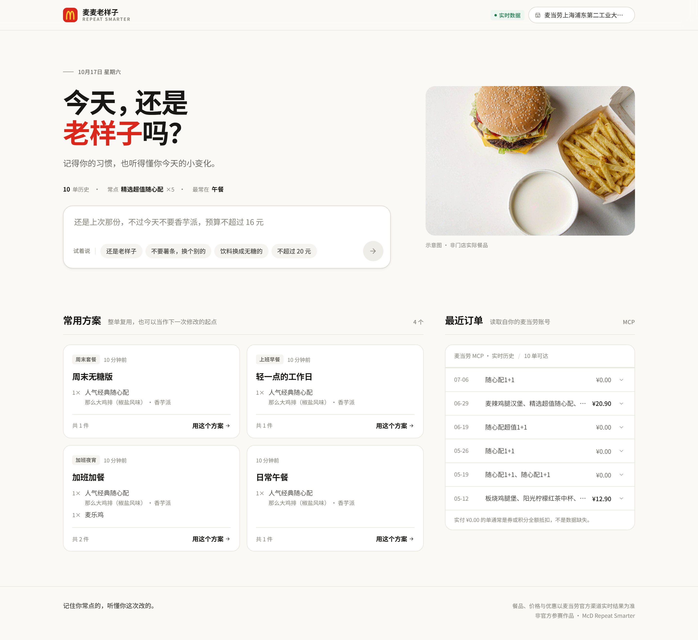
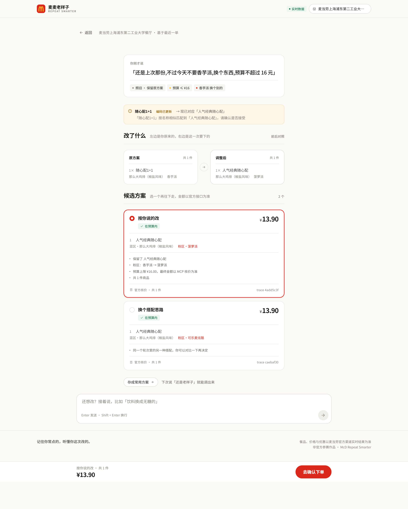
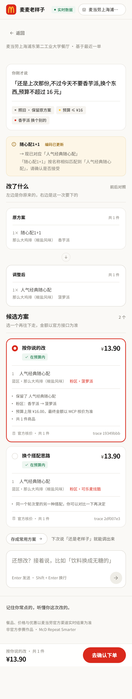

# 麦麦老样子 · McD Repeat Smarter

> 记住你常点的，听懂你这次改的，确认好再帮你点。

一个基于**麦当劳中国官方 MCP** 的个性化点餐助手。它不是又一个"帮你挑套餐"的推荐机器人，而是解决一件更小、更日常、也更没人做的事：

**你昨天、上周、过去十次点的都是同一份。今天你想改一点点，怎么用一句话说清楚，并且真的点出去。**

---

## 目录

- [为什么做这个](#为什么做这个)
- [截图](#截图)
- [视觉设计](#视觉设计)
- [快速开始](#快速开始)
- [使用示例](#使用示例)
- [它到底做了什么](#它到底做了什么)
- [技术架构](#技术架构)
- [关键设计决策](#关键设计决策)
- [真实 MCP 验证](#真实-mcp-验证)
- [运行测试](#运行测试)
- [已知限制](#已知限制)
- [竞品检查](#竞品检查)
- [文件清单](#文件清单)

---

## 为什么做这个

同类工具大多从「全量菜单 + 一堆推荐」出发，用户每次都要重新做一遍选择题。但真实的老客行为不是这样的：

- 一周五个工作日，早餐基本就那两三样；
- 午餐在固定两三家门店、固定几个套餐之间轮换；
- 变化往往只有一处——"今天不要薯饼"、"饮料换无糖"、"预算压到 25 以内"。

所以本项目的起点是**你的历史订单**，交互动词是**改**，不是**选**：

| 用户会说 | 系统要做的事 |
| --- | --- |
| "还是上次那份早餐" | 找到最近一单 → 校验每件商品今天还在不在售 → 核价 |
| "还是上次那份，不过今天不要香芋派，换个东西，预算不超过 25 元" | 保留其余，只动香芋派所在的那一格，给出同轮次候选，真实核价，超预算要说清楚 |
| "存成上班早餐" | 存**结构化餐品信息**（编码/名称/规格/数量/来源），不是存一句话 |
| 确认好了 | 展示完整订单 → 用户勾选确认 → 才调用下单 |

**目标用户**：一周吃三次以上麦当劳、有自己的固定搭配、懒得每次重新翻菜单的人。

---

## 截图

**首屏**：直接告诉用户"今天还是老样子？"，下面立刻就是你的真实习惯（来自 MCP 历史订单，不是编的）。



**改完之后**：左边原方案、右边调整后，一眼看出只动了哪一格。每个候选金额都带官方核价返回的 `traceId`。



**确认抽屉**：门店、餐品（含套餐里具体选了什么）、改动内容、取餐方式、金额全列出来，**必须勾选「我已核对」下单按钮才会激活**。窄屏下应付金额常驻操作栏，不必滚动才能看到。


**移动端**：首屏、调整结果、确认页都做了单独的排版，不是桌面版缩小。





---

## 视觉设计

界面不是"聊天框 + 卡片列表"。它要同时满足两件事：**看起来像一个成熟的商业消费产品**，又**一眼能看出这是一个复购助手**而不是又一个点餐 App。

### 方向：克制的商业点单界面

参考的是麦当劳官方点餐产品那种「白底、克制品牌红、清晰商品与价格排版」的完成度，而不是照抄它的页面结构。整套系统只做三件事：

| 层 | 做法 | 用在哪 |
| --- | --- | --- |
| 底 | `#FAF9F6` 暖白 + 纯白卡片 + 1px 描边 | 全站，靠半级明度差和细线分层，不靠阴影 |
| 字 | Noto Sans SC 真实字重 300/400/500/700 + 四级灰阶 | 标题、正文、标签、注释各有固定字号与颜色 |
| 红 | `#DA291C` 只出现在品牌标记、主按钮、当前选中项、关键价格 | 全屏红色区域不超过三处 |

品牌标记是 30px 红底 + 金色拱门（`src/components/Icons.tsx` 的 `IconArches`），是全站唯一的双色构件，也是唯一一处金色。拱门用一条粗描边画骨架而不是填实心剪影：拱内留白，缩到 17px 仍读得出「两个拱」；腿在下半段保持竖直、拱顶收窄成尖圆，否则会读成小写字母 `m`。favicon 用同一份路径。

刻意没有做的：渐变、玻璃拟态、大面积模糊阴影、超大圆角、随机旋转、贴纸与手绘涂鸦、装饰性插画。**一屏只允许一个视觉焦点**——首屏是标题和输入区，结果页是候选方案，确认页是「应付」。

### 排版

- 主标题 `clamp(34px, 4.6vw, 56px)`，字距 `-0.038em`，行高 1.14 —— 中文大字必须收紧字距才不散
- 首屏标题手动断行：「今天，还是 / **老样子**吗？」。中文全角逗号自带右侧空白，交给浏览器自动折行会出现伪空格
- 正文行宽用 `em` 不用 `ch`：中文 `1ch` 只有半个汉字宽，用 `ch` 会算出过窄的栏宽，把句子切成三行还留孤字
- 金额与单号统一 `font-variant-numeric: tabular-nums`，价格列左右都对齐成一条竖线
- 英文小标签（`REPEAT SMARTER`、`CHECKOUT`）用 10–11px + `0.16em` 字距；**中文标签只给 `0.02em`**——中文被拉散会立刻显得业余
- 含中文的脚注一律不用等宽字体，只让纯数字走 mono

### 信息层级

一个页面只允许一个"主角"：

- **首屏**主角是标题 + 一句话输入；常用方案与最近订单降到次级，用细线章节头分隔，不做成首屏主视觉
- **结果页**主角是候选方案，选中态用 2px 红边（`inset` 描边，不是发光外圈），价格用 23px 紧字距数字
- **确认页**主角是「应付」金额，正文里不再重复一次总额
- 解释性文字用 12px 淡灰 + 中点前缀，不用对勾——这套界面里对勾的含义是「已核验」，滥用会稀释它

### 结果页刻意收窄

首页是浏览型页面，铺满 1180px；**结果页是决策型页面，收窄到 900px 并居中**，吸底栏沿用同一宽度。用户在这里是逐条核对「改了什么」，不是横向扫视。

### 数据可信度

- 顶部常驻「实时数据 / 演示数据」徽标，颜色来自真实 `mode`
- 首屏主图标注「示意图 · 非门店实际餐品」，不冒充真实商品
- 历史订单里实付 `¥0.00` 单独解释为券或积分抵扣，不显示成一排「—」
- 思考态只展示真实经过的秒数和不确定进度条，**不伪造分步打勾**——`/api/adjust` 是一次 HTTP 请求，前端无法知道内部进度

### 动效与微交互

| 位置 | 行为 |
| --- | --- |
| 输入区 | `:focus-within` 时 1px 红边 + 4px 红色外晕，是页面里唯一的聚焦信号 |
| 方案卡 | hover 上浮 2px + 边框加深 + 阴影；操作图标平时收起，hover / 聚焦才出现（触屏常驻） |
| 「用这个方案」 | hover 时箭头右移，间距 3px → 7px |
| 历史订单 | 点击展开明细，箭头旋转 180°，内容 `unfold` 展开 |
| 发送键 | 悬停加深、按下缩到 0.94；空值时降级为灰底 |
| 候选卡 | hover 边框加深；选中时 2px 红边 + 单选圆点填充 |
| 遮罩弹层 | `blur(3px)` + 压暗 42%；桌面居中，移动端从底部升起 |
| 无障碍 | 全局 `prefers-reduced-motion` 降级；所有可点元素有 `:focus-visible` 描边 |

### 响应式

- `1080px`：首页两栏（左常用方案 + 右最近订单）收成单栏，方案排三列
- `940px`：首屏由「标题 / 输入 / 图片」双栏改为单栏，顺序变成 **标题 → 图片 → 输入**，输入区仍在首屏内
- `720px`：顶栏 `56px`、方案单列、前后对照改为上下叠放且箭头转为向下、弹层改底部抽屉、吸底栏适配 `safe-area-inset-bottom`、快捷短语横向滚动并做右侧淡出

底部留白跟随状态变化：**没有吸底栏时页面不会留出 96px 空档**，由根节点的 `.app--has-actionbar` 类控制。

## 快速开始

### 1. 申请 MCP Token

打开 <https://open.mcd.cn/mcp> → 手机号登录 → 右上角「控制台」→「激活」→ 同意协议 → 复制 Token。

### 2. 安装与配置

```bash
git clone <this-repo>
cd mcd-repeat-smarter
npm install

cp .env.example .env
# 编辑 .env，填入 MCD_MCP_TOKEN=你的Token
# 可选：MCD_DEFAULT_STORE_CODE=1450543（默认门店，留空则在界面里选）
```

### 3. 运行

```bash
# 开发模式（前端 5173 + 服务端 8787，vite 自动代理 /api）
npm run dev

# 生产模式（构建后用 8787 单端口提供页面与 API）
npm run build
npm start
```

打开 <http://127.0.0.1:8787>。

> **不要同时开着 dev 和 start。** 两者都监听 8787，后启动的那个会直接退出（提示"端口已被占用"并给出换端口/查进程的命令）。切换模式前先用 `Ctrl+C` 停掉前一个，或 `PORT=8788 npm start` 换个端口。

### 4. 不想配 Token？

```bash
DEMO_MODE=true npm run dev
```

会用内置演示数据跑通完整流程。**演示模式在界面上有强制警示条，所有金额标记为演示数据，下单接口只返回模拟结果并明确说明"没有创建真实订单"。**

### 5. 自检连接是否正常

```bash
npm run mcp:probe
```

只读调用，不会创建订单。会列出当前 MCP Server 暴露的全部 Tool、门店在售商品数、可读历史订单数，以及一次真实核价的明细（含 `traceId`）。

---

## 使用示例

下面这些是**真机上跑过的输入**（门店：麦当劳上海浦东第二工业大学餐厅，`1450543`，到店自取）。

### 例 1：只改一处，带预算

> `还是上次那份，不过今天不要香芋派，换个东西，预算不超过 16 元`

系统行为：

1. 从 `order-list` 取最近一单：`随心配1+1`（那么大鸡排（椒盐风味）+ 香芋派）；
2. 发现 `随心配1+1`（`9900010829`）**已不在当前门店在售菜单里**；
3. 按核心词重匹配到在售的 `人气经典随心配`，并在界面上**明确提示"编码已更新 → 现已对应「人气经典随心配」"**；
4. 在粉区里把香芋派换成另一种派/小食，给出 2 个候选；
5. 每个候选各调一次 `calculate-price`，金额来自官方核价（本例 ¥13.90，在 ¥16 预算内）。

### 例 2：原样重复

> `还是老样子`

不做任何修改，直接核价 + 进入确认流程。如果历史里有商品下架，会先告诉你。

### 例 3：加一件

> `加一份麦乐鸡`

在原方案基础上新增，原方案其余内容一字不动。

### 例 4：存成常用方案

调好之后点「存成常用方案」→ 选场景（上班早餐 / 日常午餐 / 周末套餐 / 加班夜宵）→ 命名。

存的是结构化数据：

```json
{
  "id": "plan_xxx",
  "name": "我的日常午餐",
  "storeCode": "1450543",
  "storeName": "麦当劳上海浦东第二工业大学餐厅",
  "beType": 1,
  "tag": "日常午餐",
  "source": "user",
  "items": [
    {
      "productCode": "9900013291",
      "name": "人气经典随心配",
      "quantity": 1,
      "isCombo": true,
      "children": [
        { "code": "521156", "name": "那么大鸡排（椒盐风味）", "quantity": 1, "round": "1", "roundName": "蓝区" },
        { "code": "4106", "name": "菠萝派", "quantity": 1, "round": "2", "roundName": "粉区" }
      ]
    }
  ],
  "createdAt": "2026-10-17T10:58:00.000Z"
}
```

**注意这里没有存价格。** 价格有时效性和门店差异，下次用之前一定重新 `calculate-price`。方案落盘到 `data/plans.json`（原子写 + 串行化，重启后仍可读）。

---

## 它到底做了什么

### 模块拆分

| 模块 | 文件 | 职责 |
| --- | --- | --- |
| 意图解析 | `server/domain/intent.ts` | 确定性规则引擎（正则 + 中文数字），把"不要薯饼，换个东西，不超过 25"拆成 `remove / replace(open) / budget`。不依赖 LLM，结果可复现、可单测 |
| 原方案匹配 | `server/domain/matcher.ts` | 商品身份重匹配：`exact / renamed / unavailable / substituted / unmatched`，处理"换码但同名"和"已下架" |
| 候选生成 | `server/domain/planner.ts` | `minimal`（严格照做）、`swap-fit`（同轮次另一种搭配）、`budget-fit`（仅超预算时） |
| 价格核算 | `server/mcp/mcdService.ts` + `server/domain/pricing.ts` | 调用官方 `calculate-price`，再做**覆盖性 / 合计一致性 / 零金额**三类自检 |
| 预算校验 | `server/domain/pricing.ts` | 与用户预算比较，超预算必须写明原因，**不允许静默突破** |
| 确认状态 | `server/routes/api.ts` | 两段式：`/order/preview` 发一次性令牌 → `/order/confirm` 校验 `confirmed === true` |
| 持久化 | `server/store/planStore.ts` | JSON 落盘，临时文件 + rename 原子写，写操作串行化 |
| 数据来源 | 全局 | 每个对象带 `source: 'mcp' \| 'user' \| 'demo'`，UI 必须区分展示 |

### 一次「调整」的完整链路

```
POST /api/adjust
 ├─ 规则引擎 → ParsedIntent
 ├─ 取原方案（order-list 最近一单 / 用户保存的方案）
 ├─ query-meals        → 门店当前在售清单
 ├─ query-meal-detail  → 套餐轮次结构（判断子项是否还合法、有哪些替代）
 ├─ matchPlan()        → 身份重匹配（含别名、换码、下架）
 ├─ buildCandidates()  → 2~3 个候选（每个都带"为什么给你这个"）
 ├─ calculate-price ×N → 逐候选真实核价
 ├─ verifyBreakdown()  → 价格自检
 └─ markBudget()       → 预算判定 + 超预算说明
```

---

## 技术架构

```
浏览器 (React 19 + TS + Vite)
   │  只发业务请求，永远拿不到 Token
   ▼
Express (Node)  ← MCD_MCP_TOKEN 只在这里
   ├── server/mcp/client.ts      手写 MCP Streamable HTTP 客户端（JSON-RPC 2.0）
   ├── server/mcp/mcdService.ts  业务适配层（单位归一、字段映射）
   ├── server/domain/*           纯函数领域逻辑（意图 / 匹配 / 规划 / 定价）
   ├── server/store/planStore.ts 常用方案持久化
   └── server/routes/api.ts      对外 API + 下单安全闸门
   ▼
https://mcp.mcd.cn  (麦当劳官方 MCP Server)
```

**为什么不用 MCP SDK：** 只有 `initialize`、`tools/list`、`tools/call` 三个方法，手写 226 行即可，省掉一个依赖，也更容易看清"Token 具体在哪一行被使用"。

**领域层是纯函数**：`intent / matcher / planner / pricing` 不碰网络、不碰文件，因此可以用固定 fixture 做单元测试，79 个测试里 57 个属于这一类。

### 目录结构

```
mcd-repeat-smarter/
├── server/
│   ├── mcp/          MCP 客户端、真实实现、演示实现、网关接口
│   ├── domain/       类型、意图、匹配、规划、定价、习惯画像
│   ├── store/        常用方案持久化
│   ├── routes/       API 路由
│   ├── config.ts     网关工厂（有 Token 才连真实 MCP）
│   ├── app.ts        createApp(gateway)，便于测试注入
│   └── index.ts      启动入口
├── src/              React 前端
│   ├── components/   Composer / HabitBar / PlanCard / AdjustResultView / ConfirmSheet / StorePicker
│   └── styles/       设计系统（暖白底 + 克制品牌红 + 四级灰阶 + 真实字重排版）
├── tests/            79 个测试
├── scripts/          probe-mcp.ts（MCP 自检）、screenshots.mjs（UI 截图）
└── docs/             竞品检查、截图
```

---

## 关键设计决策

**1. 金额一律用「分」的整数存储。**
`calculate-price` 返回「分」，`query-meals` 的 `currentPrice` 是「元」的字符串。混用会差 100 倍。统一在入口转成「分」，只在渲染时除以 100。

**2. 商品身份与展示信息分离，并且承认"身份会漂移"。**
真实数据里，用户最爱的 `随心配1+1`（`9900010829`）已经下架。直接报错是偷懒，静默换成别的是欺骗。做法是：按核心词重匹配到在售商品 + **显式告知"编码已更新，现已对应 XX，请确认"**，并保留 `aliasNames`，让用户之后仍能用旧名字提修改。

**3. 价格只来自 MCP，模型不参与算钱。**
所有金额都对应一次真实的 `calculate-price`，界面上能看到 `traceId`。演示模式的金额带 `source: 'demo'`，绝不冒充。

**4. 下单是两段式的。**
`/order/preview` 会再核一次价，并签发一个 5 分钟有效、绑定门店/商品/金额/取餐方式的一次性令牌；`/order/confirm` 必须带 `confirmed: true` 和这个令牌。少了任何一样都是 428 / 410。**UI 上的下单按钮在勾选前是 disabled 的，绕过 UI 直接打接口也拿不到 200。**

**5. 意图解析用规则引擎，不用 LLM。**
"不要 X，换个东西，不超过 25" 这类句式高度集中，正则 + 中文数字解析就够，而且结果稳定可测。代价是能理解的句式有限——这是明确的取舍，不是遗漏（见[已知限制](#已知限制)）。

**6. 不理解的地方不猜。**
解析器识别不了的片段会进 `unrecognized`，界面会提示"有一部分没听懂"并给出可用说法示例，而不是假装懂了乱改。

---

## 真实 MCP 验证

`npm run mcp:probe` 的真实输出（2026-10-17）：

```
端点：https://mcp.mcd.cn
门店：1450543 ｜ 取餐方式 beType=1

1. 服务端实际暴露的 Tool（tools/list）
共 35 个

2. 门店菜单（query-meals）
在售商品 102 个（orderType=1）

3. 历史订单（order-list）
可读取订单 10 单

4. 官方核价（query-meal-detail + calculate-price）
套餐：9900005456 麦辣鸡腿汉堡三件套
轮次：麦辣鸡腿汉堡 / 选择套餐内小食 / 选择套餐内饮料
合计 33.50 元（原价 33.50 元，优惠 0.00 元）
数据来源 source=mcp ｜ traceId=6e49dc0cdae58e8876891077361f39a1
```

本项目实际使用了 7 个 Tool：`query-nearby-stores`、`query-meals`、`query-meal-detail`、`order-list`、`calculate-price`、`query-my-coupons`、`create-order`。

详细的入参、出参、调用流程和踩过的坑，见 **[MCP_INTEGRATION.md](MCP_INTEGRATION.md)**。

---

## 运行测试

```bash
npm test          # vitest，79 个测试
npm run typecheck # tsc --noEmit
npm run build     # tsc --noEmit && vite build
```

当前状态：**79 passed / typecheck 无错误 / build 成功（gzip 约 83 KB）**。

覆盖范围：

| 测试文件 | 数量 | 覆盖什么 |
| --- | --- | --- |
| `tests/intent.test.ts` | 13 | 中文数字（"二十五"/"十五"）、否定语境（"不要"里的"要"不是新增）、开放式替换、"换个东西"升级为无目标替换 |
| `tests/matcher.test.ts` | 17 | 换码同名、别名保留、下架替代、跨轮次名称搜索、模糊匹配阈值 |
| `tests/planner.test.ts` | 16 | 保留/删除/替换/新增、套餐删项后补位、候选生成、预算标记 |
| `tests/pricing.test.ts` | 11 | 覆盖性校验、合计一致性、零金额、价差计算、预算判定 |
| `tests/store.test.ts` | 7 | 真实落盘、新建 store 实例能读到（模拟重启）、并发写不互相覆盖、文件损坏不抛错 |
| `tests/api.test.ts` | 15 | 未确认时下单被拒（428）、伪造令牌（410）、非法取餐方式（400）、令牌一次性 |

`tests/api.test.ts` 里有专门的用例断言：**没有显式确认时，`createOrder` 一次都不会被调用**——用一个会计数的网关包住实现，验证"未确认 / confirmed=false / 伪造令牌"三种情况下副作用函数的调用次数都为 0，只有显式确认后才恰好为 1。

---

## 已知限制

诚实列出来，不粉饰：

| 限制 | 原因 | 影响 |
| --- | --- | --- |
| 只支持到店自取 | UI 当前只开放 `beType=1`；麦乐送/得来速/团餐需要地址、门店时段等额外参数 | 外送用户暂时用不了 |
| 历史订单不返回轮次，也不返回图片 | MCP 的 `order-list` 字段所限 | 子项轮次靠"按名称反查当前套餐结构"推断，同名商品出现在多个轮次时可能推错，此时会标记为需确认；「原方案」列没有商品图 |
| 不会还原上次的特制项 | 历史订单不返回用户上次选的少冰/去酱 | 「老样子」还原的是餐品结构，不含特制偏好 |
| 意图解析能覆盖的句式有限 | 规则引擎，不是 LLM | 复杂说法（"我想换个口味但别太辣"）会被标记为没听懂，而不是瞎猜 |
| 不做反向求解 | 只能执行用户明确说的改动 | 预算不满足时给最接近的方案 + 说明原因，不会偷偷换掉你要的东西 |
| 单笔只能用 1 张券 | 官方规则 | 不做多券叠加，不代选券 |
| 常用方案是单机文件存储 | 无后端账号体系 | 换设备/换浏览器拿不到，多人共用一台机器会共享 |
| 演示数据是内置的 | 无 Token 时的体验模式 | 只用于演示流程，不代表真实供应情况 |

---

## 竞品检查

开发前做过一次竞品检查，结论和**没查清的部分**都写在 **[docs/COMPETITIVE_CHECK.md](docs/COMPETITIVE_CHECK.md)**。

摘要：

- 排行榜 108 个项目，第 1 名 473★、第 100 名 13★，省钱 / 热量 / 决策 / 派对 / MBTI 等方向已经非常饱和；
- 与本项目最接近的是组合优化类（`mthli/mcd-order`，"求最省方案 + 默认不下单"）和交互式点单类（`麥門搭子`，"全量菜单点单 + 确认后下单"）；
- 差异点在"以我的历史为起点 + 增量修改是一等公民 + 商品身份漂移显式处理"这三条；
- **没有逐个审阅全部仓库源码，因此不宣称"已证明没有竞争对手"**，无法核实项在文档里逐条标记为「未知」。

---

## 文件清单

| 文件 | 说明 |
| --- | --- |
| `README.md` | 本文件 |
| `CONTEST_DECLARATION.md` | 参赛声明（**官方原文，未做任何改动**） |
| `MCP_INTEGRATION.md` | MCP Server / Tool / 调用流程 / 业务价值 / 能力边界 |
| `mcp-config.example.json` | MCP 客户端配置示例（仅环境变量占位符） |
| `.env.example` | 环境变量模板（无真实 Token） |
| `workbuddy.md` | 本次开发的 WorkBuddy 真实对话记录导出（Token 已脱敏） |
| `server/` `src/` | 源代码 |
| `tests/` | 79 个测试 |
| `scripts/probe-mcp.ts` | MCP 能力自检（只读） |
| `scripts/screenshots.mjs` | UI 截图脚本（会走完流程但不提交订单） |
| `docs/COMPETITIVE_CHECK.md` | 竞品检查记录 |
| `docs/DEVELOPMENT_SUMMARY.md` | 开发过程整理稿（比对话记录更适合快速了解全貌） |

---

## 免责声明

本项目为**麦当劳程序员节创意开发大赛参赛作品**，由参赛者独立开发，非麦当劳官方产品。
餐品信息、价格及供应状态以麦当劳官方渠道的实时结果为准。项目不包含任何真实 Token、密钥或他人个人信息，配置文件仅使用环境变量占位符。
